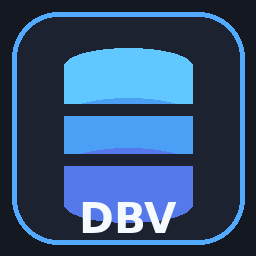

<div align="center">



# DBV — Database Viewer & SQL Workbench

[](https://github.com/Nighty3098/DBV_vscode/actions/workflows/ci.yml)
[](LICENSE)

DBV is a free, open-source database explorer for **VS Code** and **VSCodium**. It opens SQLite files as rich visual editors, keeps saved server connections, runs SQL, browses huge tables with server-side pagination, and edits records safely. No paid tiers, telemetry, accounts, or proprietary services.

</div>

## Highlights

- **SQLite custom editor** — click any `.sqlite`, `.sqlite3`, `.db`, `.db3`, `.s3db`, or `.gpkg` file and inspect it immediately.
- **SQL workbench** — `.sql` files open in a query workbench with schema explorer, query history, export, and save support. Reopen as plain text from the editor title menu.
- **Saved connections** — DBeaver-style host/port session wizard for PostgreSQL, MySQL, MariaDB, and SQL Server. Passwords live in VS Code **Secret Storage**, never in settings or workspace files.
- **Huge databases** — tables are fetched page by page (100–2,000 rows) instead of loading the database into memory. SQLite uses Node's built-in SQLite engine and keeps files on disk.
- **Data editing** — insert, update, and delete rows; inline table filters; sorting; SQL NULL handling; full schema view with DDL, columns, indexes, and foreign keys.
- **Export** — CSV, JSON, JSON Lines, and INSERT statements.
- **Work wherever VS Code runs** — desktop VS Code, VSCodium, insiders, remote SSH/WSL/dev containers (`workspace` extension kind).
- **Open source and free forever** — MIT licensed, no sponsor blocks, no upsell.

## Database support

| Engine     | Browse | Query | Edit rows | Saved sessions | Notes                           |
| ---------- | ------ | ----- | --------- | -------------- | ------------------------------- |
| SQLite     | ✅     | ✅    | ✅        | ✅             | Local files; opens by extension |
| PostgreSQL | ✅     | ✅    | ✅*       | ✅             | Host, port, SSL modes           |
| MySQL      | ✅     | ✅    | ✅*       | ✅             | Host, port, SSL modes           |
| MariaDB    | ✅     | ✅    | ✅*       | ✅             | MySQL-compatible                |
| SQL Server | ✅     | ✅    | ✅*       | ✅             | SQL login; TLS options          |

\* Editing remote tables requires a primary key. SQLite falls back to the built-in `rowid` for ordinary tables without an explicit primary key.

## Quick start

1. Install the extension from a VSIX (`Extensions: Install from VSIX…`).
2. Open a `.db`/`.sqlite` file, or use the DBV activity-bar icon to add a connection.
3. For a server, choose the engine, host, port, database, user, password, and SSL mode.
4. Browse a table in the explorer, double-click a cell to edit it, or open **Query** to run SQL.
5. `Ctrl+Enter`/`Cmd+Enter` runs the current statement or selection in the workbench.

### SQL files

`.sql` files are associated with the DBV workbench by default. To get the normal text editor for one file, open the editor title menu and choose **Reopen DBV Editor as Text**, or use **Reopen Editor With… → Text Editor**. The **New SQL Query** command creates a scratch `.sql` document outside your workspace; use **Save As** to keep it in a project.

## Connections and secrets

Saved connection metadata is stored in VS Code's global state. Passwords are stored with the VS Code Secret Storage API, which delegates to the operating system keychain. Removing a connection deletes its secret. SQLite file paths are stored as plain paths. DBV never sends database contents anywhere except to the database you configured.

## Large databases

- The table viewer uses `LIMIT/OFFSET` pages and only counts rows on the first page.
- For tables without a primary key, SQLite uses a parameterized `rowid` locator so edits/deletes remain exact.
- Ad-hoc queries are capped by `dbv.maxResultRows` (default 1,000) to protect the webview.
- Export reads up to 100,000 rows per operation; the UI warns when the cap is reached.
- SQLite files are opened directly by `node:sqlite`; they are **not** copied into memory. VS Code 1.105+ (Node 22.17+) is required.

## Configuration

| Setting                         | Default | Description                                 |
| ------------------------------- | ------- | ------------------------------------------- |
| `dbv.pageSize`                  | `200`   | Rows fetched per page.                      |
| `dbv.maxResultRows`             | `1000`  | Ad-hoc query result cap.                    |
| `dbv.queryTimeout`              | `60`    | Query timeout in seconds.                   |
| `dbv.confirmDestructiveActions` | `true`  | Confirm row deletes, drops, and truncation. |
| `dbv.defaultRows`               | `200`   | Initial row count.                          |
| `dbv.showNullAs`                | `NULL`  | Visual NULL marker.                         |
| `dbv.autoConnect`               | `false` | Connect saved sessions on activation.       |

## Commands

- `DBV: Add Database Connection`
- `DBV: Open SQLite Database File`
- `DBV: New SQL Query`
- `DBV: Open File with DBV`
- `DBV: Open Query in DBV`
- `DBV: Export Table`
- `DBV: Show Query History` / `Clear Query History`
- `DBV: Reopen DBV Editor as Text`

## Architecture

```
src/
  core/              Pure SQL builders, validation, serialization, export, history
  extension/         VS Code integration, drivers, custom editors, tree, sessions
    drivers/         SQLite (node:sqlite), PostgreSQL (pg), MySQL (mysql2), SQL Server (mssql)
  shared/            Host ↔ webview protocol types
  webview/           React workbench, CodeMirror SQL editor, virtualized-by-page data grid
tests/               Core unit tests + real SQLite integration tests
```

- **No native dependencies** are needed for SQLite. Server drivers are pure-JS packages bundled into `dist/extension.js`.
- **Security boundaries**: SQL identifiers come from schema metadata and are quoted; sort/filter columns are allow-listed; all cell/filter values are bound parameters. Only the explicit SQL workbench executes user-authored SQL.
- **Webview**: strict CSP, no remote assets, React text escaping.

## Development

```bash
npm ci
npm run build       # bundle extension, webview, CSS
npm test            # 25 tests
npm run test:coverage
npm run compile     # TypeScript check
```

Press `F5` to launch the Extension Development Host. See [CONTRIBUTING.md](CONTRIBUTING.md).

### Test coverage

The CI-only coverage gate includes the pure SQL/validation/export layer and the real SQLite driver. Current result: **100% statements, 100% functions, 100% lines**, with 96%+ branch coverage. Tests create a temporary SQLite database and exercise browse, sort, filter, rowid fallback, update, insert, delete, views, truncation, DDL metadata, read-only enforcement, query caps, and error paths.

Server drivers are type-checked and follow the same contract; live PostgreSQL/MySQL/SQL Server integration tests require external services and are intentionally not run in CI.

## Research and feature provenance

See [docs/RESEARCH.md](docs/RESEARCH.md) for the analysis of SQLite Viewer by qwtel, SQLTools, DBeaver, DBCode, and related tools. DBV is an independent clean-room implementation; no code from those projects is bundled.

## Known limitations

- Query cancellation is not implemented for server drivers.
- ER diagrams and visual table designers are on the roadmap.
- Importing CSV is not yet exposed in the UI; SQL inserts can be run in the workbench.
- SQL Server `GO` batch separators are not interpreted.
- `.sql` files open in DBV by default. Use **Reopen Editor With…** if you prefer the plain text editor.

## Contributing

Contributions are welcome. Commits follow [Conventional Commits](CONTRIBUTING.md#commit-standards). Please keep pull requests focused and add tests.

## License

MIT © Artem (Nighty3098). See [LICENSE](LICENSE).
